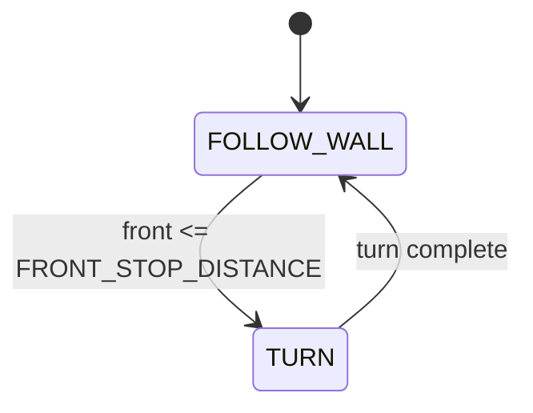

# Challenge 4: Corner Detection - First State Machine

## Purpose

Move from a single control loop to a two-state machine so the robot can switch between wall following and turning when the front wall blocks the path.

## Shared Config Transition

1. **Keep These Settings:** Driving and Wall PID in [config.py](../project/config.py).
2. **Tune These Settings:** Front Distance Control and Turn Control. Leave advanced Turn Mechanics at baseline initially.
3. **New Main Behaviour:** Front approach slowdown, `FOLLOW_WALL`/`TURN` states and a visible gyro turn helper.
4. **Replace Main:** Use the [Challenge 4 main](../app/starter-code/challenge-4.py) as `main.py`. Keep your existing config.

Read the [shared configuration instructions](README.md#shared-configuration). All settings below live in config; `state` and PID history are runtime values in main.

## Success Criteria

The robot follows the wall, detects a front wall, performs a 90 deg gyro turn away from the wall, and reaches the green exit zone.

## Before You Begin

1. Complete Challenge 3 with stable side PID.
2. Open simulator Challenge 4.
3. Confirm `WALL_SIDE` and `DISTANCE_SENSOR` in config.

## Maze Situation

- Maze feature: inside corner with wall directly ahead.
- Trigger condition expected in code: `front <= FRONT_STOP_DISTANCE`.
- New behavior introduced: explicit state transition from Follow wall state to Turn state.
- Why previous challenge fails: side-only control cannot respond to a front blockage.

## What Is New In This Challenge

New: finite state machine with two states.

Unchanged: side PID logic from Challenge 3 in Follow wall state.

State delta:

1. `FOLLOW_WALL` handles normal corridor control.
2. `TURN` performs gyro-closed-loop 90 deg turn.

## Settings Used In This Main

| Group   | Variable                                                 | Notes                                            |
| ------- | -------------------------------------------------------- | ------------------------------------------------ |
| Reused  | `BASE_SPEED`, side PID tunables                          | Follow wall behavior stays the same.             |
| New     | `FRONT_SLOW_DISTANCE`, `FRONT_STOP_DISTANCE`, `FRONT_Kp` | Front approach slowdown and stop trigger.        |
| New     | `turn_Kp`, `turn_Kd`, `turn_tolerance`                   | Gyro turn tuning.                                |
| New     | `state`                                                  | Current FSM state label.                         |
| Removed | None                                                     | Previous PID block is embedded in `FOLLOW_WALL`. |

## Algorithm Flow

### State Table

| State name    | Responsibilities                                            | Exit conditions                           |
| ------------- | ----------------------------------------------------------- | ----------------------------------------- |
| `FOLLOW_WALL` | Run side PID, check front distance, apply approach slowdown | Exit to `TURN` when front trigger fires   |
| `TURN`        | Brake, rotate 90 deg using gyro PID, reset side PID history | Exit to `FOLLOW_WALL` when turn completes |

### Trigger Table

| Trigger condition                              | From state    | To state      | Priority |
| ---------------------------------------------- | ------------- | ------------- | -------- |
| `front != -1 and front <= FRONT_STOP_DISTANCE` | `FOLLOW_WALL` | `TURN`        | High     |
| Turn error <= tolerance                        | `TURN`        | `FOLLOW_WALL` | High     |

## Starter Code Contract

Safe to tune in shared config:

1. Front approach tunables.
2. Turn gains (`turn_Kp`, `turn_Kd`, `turn_tolerance`).
3. Carry-forward side PID tunables.

Keep these algorithm invariants when editing main:

1. State loop dispatch.
2. Trigger ordering.
3. Gyro integration structure.
4. Safety timeouts and clamps.
5. The advanced Turn Mechanics settings (`TURN_KICK_*`, `TURN_COAST_TIME`, `NUDGE_*`) retain their units and safety roles.

Optional debug edits:

1. Print current `state`, `front`, and turn error.

## How The Turn Works

The turn is not a plain PID loop, because the motors have a dead zone and the
robot keeps rotating after the power is cut. It runs in three phases:

1. **Kick** - `TURN_KICK_SPEED` for `TURN_KICK_STEPS` breaks static friction, and
   the sign of the gyro during the kick is recorded so an inverted IMU cannot
   flip the loop.
2. **PID cruise** - `turn_Kp` / `turn_Kd` set the spin speed, clamped between
   `MIN_TURN_SPEED` and `TURN_MAX_SPEED`. Braking is predictive: power is cut
   when `heading + (rate * TURN_COAST_TIME)` reaches the target, not when the
   target is already passed. `TURN_TIMEOUT_MS` caps a bad turn.
3. **Settle and nudge** - the gyro keeps integrating through the coast
   (`TURN_SETTLE_STEPS`), then any error left over is closed with short pulses
   at `NUDGE_SPEED`, because the motors stall below `MIN_TURN_SPEED` and cannot
   simply creep to the target.

Begin with the P gain, D gain and tolerance in Turn Control. Advanced Turn
Mechanics describe the chassis and its safety budgets; change them only after
measuring a repeatable physical effect. `TURN_PAUSE_TIME` controls stationary
pauses, and `NUDGE_SETTLE_STEPS` controls coast sampling after correction pulses.

## Tunables

| Name                  | Unit | Purpose                        | Typical range | Symptoms when too low     | Symptoms when too high   |
| --------------------- | ---- | ------------------------------ | ------------- | ------------------------- | ------------------------ |
| `FRONT_STOP_DISTANCE` | mm   | Turn trigger distance          | 100-200       | Late turn, collision risk | Early turn, awkward path |
| `FRONT_SLOW_DISTANCE` | mm   | Begin deceleration zone        | 150-400       | Harsh corner entry        | Over-slow approach       |
| `FRONT_Kp`            | gain | Approach deceleration strength | 0.5-1.5       | Weak slowdown             | Over-braking             |
| `turn_Kp`             | gain | Turn speed toward target angle | 20-40         | Crawls, hits the timeout  | Slams into the clamp     |
| `turn_Kd`             | gain | Turn damping                   | 0.2-0.8       | Wobble/overshoot          | Sluggish turn            |
| `turn_tolerance`      | deg  | Completion threshold           | 1.5-3.0       | Burns through the nudges  | Stops short of square    |

Start in the middle of each range and move one gain at a time.

## Tuning Guide

1. Measure your front sensor at the desired slowdown and safe turn clearances before setting `FRONT_SLOW_DISTANCE` and `FRONT_STOP_DISTANCE`. Do not reuse the side sensor's offset; follow the [per-robot distance check](README.md#physical-distance-settings), then verify controlled corner entry.
2. Adjust turn gains for reliable 90 deg behavior.
3. Verify side PID after turn because corner exit speed affects reacquisition.

## Debug Checklist

- [ ] State changes from `FOLLOW_WALL` to `TURN` at expected front distance.
- [ ] Turn completes near 90 deg without repeated oscillation.
- [ ] Turn finishes inside the nudge budget rather than hitting the timeout.
- [ ] Side PID re-locks after turn.
- [ ] Robot reaches exit zone in repeated runs.

## Common Failure Modes

| Symptom                 | Root cause                              | Verification step                      | Fix                                               |
| ----------------------- | --------------------------------------- | -------------------------------------- | ------------------------------------------------- |
| Crashes into front wall | `FRONT_STOP_DISTANCE` too low           | Log front distance at state switch     | Increase stop distance                            |
| Turns less than 90 deg  | Nudge budget exhausted, tolerance loose | Print final turn error and nudge count | Tighten `turn_tolerance`, raise `turn_Kp`         |
| Overshoots turn         | Coast not accounted for                 | Observe angle after power is cut       | Increase `turn_Kd`, then `TURN_COAST_TIME`        |
| Turn never starts       | Spin speed below the motor dead zone    | Print the commanded spin speed         | Keep `MIN_TURN_SPEED` at or above the stall speed |
| Jerky corner entry      | Poor front slowdown tuning              | Log approach speed vs front distance   | Increase `FRONT_SLOW_DISTANCE` or `FRONT_Kp`      |

## Exit Check

Pass when the Success Criteria are met in at least 3 consecutive simulator runs.

## What Is Next

Challenge 5 adds Outside corner or nib handling with a new NIB_WALL state and wall-lost debounce logic.
