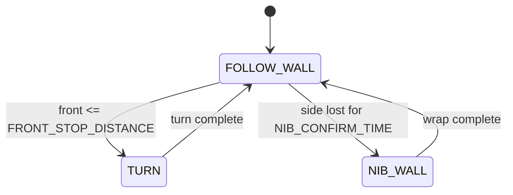

# Challenge 5: Outside Corners - Add NIB_WALL State

## Purpose

Extend the state machine to handle outside corners where the side wall disappears.

## Shared Config Transition

1. **Keep These Settings:** Wall PID, Front Distance Control and turn sections in [config.py](../project/config.py).
2. **Tune These Settings:** Outside Corners: loss threshold, confirmation time, forward clearances and reacquisition budget.
3. **New Main Behaviour:** Debounce wall loss, turn toward the followed wall and search for the new wall.
4. **Replace Main:** Use the [Challenge 5 main](../app/starter-code/challenge-5.py) as `main.py`. No tuning values need copying.

Read the [shared configuration instructions](../app/README.md#shared-configuration). `nib_lost_time` and PID history stay in main. Debounce uses `config.LOOP_DT`.

## Success Criteria

The robot detects side-wall loss at a nib, runs the wrap maneuver, reacquires the wall, and reaches the goal pocket.

## Before You Begin

1. Complete Challenge 4 with working turn behavior.
2. Open simulator Challenge 5.
3. Keep the existing config with all tuned side and turn parameters.

## Maze Situation

- Maze feature: outside corner (nib) where side wall ends.
- Trigger condition expected in code: side wall lost for confirmation time.
- New behavior introduced: NIB_WALL state for wrap-around maneuver.
- Why previous challenge fails: with no side wall, follow logic drives into open space.

## What Is New In This Challenge

New: wall-lost debounce and nib wrap state.

Unchanged: front-triggered TURN state and side PID follow state.

## Settings Used In This Main

| Group   | Variable                                  | Notes                                                           |
| ------- | ----------------------------------------- | --------------------------------------------------------------- |
| Reused  | Side PID and front-turn tunables          | Same values as Challenge 4.                                     |
| Reused  | `gyro_turn_pid` and its fixed mechanics   | Unchanged from Challenge 4; only the sign of the angle differs. |
| New     | `NIB_LOST_DISTANCE`, `NIB_CONFIRM_TIME`   | Side-wall loss detection.                                       |
| New     | `NIB_FORWARD_BEFORE`, `NIB_FORWARD_AFTER` | Wrap maneuver distances/times.                                  |
| New     | `NIB_REACQUIRE_MS`                        | Fixed: how long to creep on hunting for the new wall.           |
| New     | `nib_lost_time`                           | Debounce timer.                                                 |
| Removed | None                                      | Existing states remain.                                         |

## Algorithm Flow

### State Table

| State name    | Responsibilities                                                    | Exit conditions              |
| ------------- | ------------------------------------------------------------------- | ---------------------------- |
| `FOLLOW_WALL` | Run side PID, check front trigger, track side loss timer            | Exit to `TURN` or `NIB_WALL` |
| `TURN`        | Execute inside-corner 90 deg turn away from wall                    | Exit to `FOLLOW_WALL`        |
| `NIB_WALL`    | Drive forward, turn toward wall side, drive forward, then reacquire | Exit to `FOLLOW_WALL`        |

### Trigger Table

| Trigger condition                             | From state    | To state      | Priority |
| --------------------------------------------- | ------------- | ------------- | -------- |
| `front <= FRONT_STOP_DISTANCE`                | `FOLLOW_WALL` | `TURN`        | Highest  |
| side lost continuously for `NIB_CONFIRM_TIME` | `FOLLOW_WALL` | `NIB_WALL`    | High     |
| Wrap sequence complete                        | `NIB_WALL`    | `FOLLOW_WALL` | High     |

## Starter Code Contract

Safe to tune in shared config:

1. Nib wrap timing values.
2. Nib loss thresholds if challenge explicitly allows.
3. Existing front and side gains.

Keep these algorithm invariants when editing main:

1. Trigger priority order.
2. Debounce logic structure.
3. Turn direction mapping using wall side.

Optional debug edits:

1. Print `state`, `side`, and `nib_lost_time`.

## The Wrap Maneuver

`NIB_WALL` runs four steps, in order:

1. Drive on for `NIB_FORWARD_BEFORE`, then brake. The side sensor passes the end
   of the wall before the wheels do, so turning immediately cuts the corner.
2. `gyro_turn_pid(-TURN_ANGLE)` - the same turn as Challenge 4, negative so it
   wraps _toward_ the wall being followed.
3. Drive on for `NIB_FORWARD_AFTER`, then brake, to come alongside the new face.
4. Reacquire: creep forward for up to `NIB_REACQUIRE_MS` until the side reading
   is back inside `NIB_LOST_DISTANCE`, so a slightly short `NIB_FORWARD_AFTER`
   does not lose the run.

## Tunables

| Name                 | Unit | Purpose                            | Typical range      | Symptoms when too low | Symptoms when too high |
| -------------------- | ---- | ---------------------------------- | ------------------ | --------------------- | ---------------------- |
| `NIB_LOST_DISTANCE`  | mm   | Side distance considered wall-lost | 2-4x hold distance | False nib triggers    | Nib is never detected  |
| `NIB_CONFIRM_TIME`   | s    | Debounce before nib state          | 0.2-0.6            | Noise-triggered turns | Delayed response       |
| `NIB_FORWARD_BEFORE` | s    | Clear corner before turning        | 0.2-0.4            | Clips corner          | Wrap too wide          |
| `NIB_FORWARD_AFTER`  | s    | Move alongside new wall after turn | 0.3-0.6            | Missed reacquire      | Overshoot past wall    |

`NIB_LOST_DISTANCE` is relative, not absolute: if the side PID holds 100 mm then
a reading past roughly 250 mm means the wall has ended. A fixed value copied from
someone else's robot will either fire constantly or never fire at all.

## Tuning Guide

1. Verify debounce behavior is stable first.
2. Adjust `NIB_FORWARD_BEFORE` to avoid clipping.
3. Adjust `NIB_FORWARD_AFTER` for reliable wall reacquisition.

## Debug Checklist

- [ ] Nib trigger occurs only when wall is truly gone.
- [ ] No random nib turns on normal wall-follow oscillation.
- [ ] Wrap turn direction is toward the previous wall side.
- [ ] Robot reacquires wall and continues follow state.

## Common Failure Modes

| Symptom                  | Root cause                                            | Verification step                        | Fix                                    |
| ------------------------ | ----------------------------------------------------- | ---------------------------------------- | -------------------------------------- |
| Random nib turns         | `NIB_LOST_DISTANCE` too low or confirm time too short | Plot side reading around trigger         | Increase threshold and/or confirm time |
| Nib never detected       | `NIB_LOST_DISTANCE` far above the hold distance       | Print the side reading past the wall end | Bring the threshold back to 2-4x hold  |
| Clips outside corner     | `NIB_FORWARD_BEFORE` too low                          | Observe position at turn start           | Increase `NIB_FORWARD_BEFORE`          |
| Fails to reacquire wall  | `NIB_FORWARD_AFTER` not tuned                         | Observe side reading after wrap          | Adjust `NIB_FORWARD_AFTER`             |
| Wraps in wrong direction | Wall-side mapping issue                               | Print wall sign and turn command         | Fix mapping toward wall side           |

## Exit Check

Pass when the Success Criteria are met in at least 3 consecutive simulator runs.

## What Is Next

Challenge 6 combines dead ends and nibs in one maze and validates trigger precedence in the same three-state machine.
