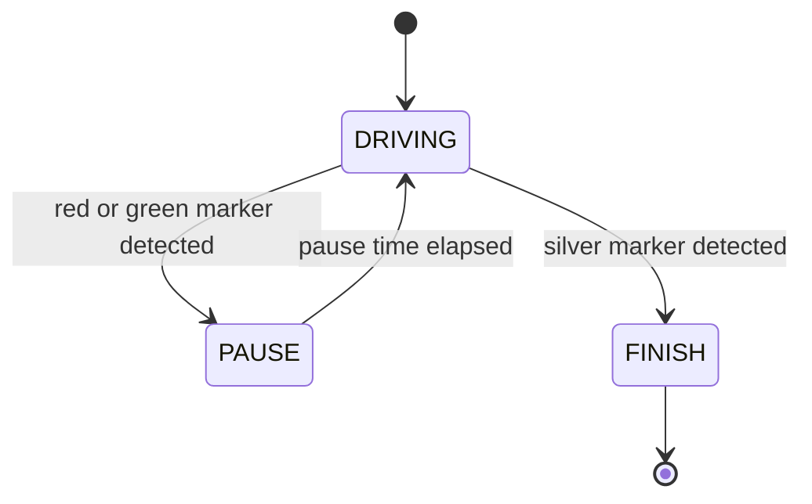

# Challenge 8: Ground Color Detection - Pause on Markers

## Purpose

Introduce color-marker handling so the robot reacts to red and green markers and recognizes silver start/finish markers.

## Shared Config Transition

1. **Keep These Settings:** Robot Setup and Driving in [config.py](../project/config.py). Earlier navigation tuning remains saved but is inactive in this corridor exercise.
2. **Tune These Settings:** Colour Detection: clear thresholds, channel ratios and `COLOR_PAUSE_TIME`.
3. **New Main Behaviour:** Drive the marker corridor, pause on new red/green markers and distinguish silver start from finish.
4. **Replace Main:** Use the [Challenge 8 main](../app/starter-code/challenge-8.py) as `main.py`. Keep config; do not replace it with colour-only settings.

Read the [shared workflow](Shared_Config_Workflow.md). Marker history and the started flag stay in main. This main does not include the full maze controller.

## Success Criteria

The robot pauses on each red and green marker for the configured pause time and reaches the silver finish marker.

## Before You Begin

1. Open simulator Challenge 8.
2. Confirm marker order in the lane.
3. Start with conservative color thresholds and tune from measured values.

## Maze Situation

- Maze feature: bright floor markers (red, green, silver) on a corridor path.
- Trigger condition expected in code: marker event from brightness interrupt gate.
- New behavior introduced: color classification and pause behavior.
- Why previous challenge fails: maze solver has no marker interpretation or pause logic.

## What Is New In This Challenge

New: marker classification pipeline and marker-driven pause behavior.

Unchanged: base movement loop style and loop timing expectations.

## Settings Used In This Main

| Group   | Variable                                                                        | Notes                                     |
| ------- | ------------------------------------------------------------------------------- | ----------------------------------------- |
| Reused  | `BASE_SPEED`                                                                    | Movement baseline remains.                |
| New     | `color_min_clear`, `color_red_ratio`, `color_green_ratio`, `color_silver_clear` | Color thresholds.                         |
| New     | `COLOR_PAUSE_TIME`                                                              | Pause duration for red and green markers. |
| New     | marker tracking variables                                                       | Prevent duplicate reactions per marker.   |
| Removed | NIB-specific tunables from core loop                                            | Not central to this challenge objective.  |

## Algorithm Flow



### State Table

| State name | Responsibilities                            | Exit conditions             |
| ---------- | ------------------------------------------- | --------------------------- |
| `DRIVING`  | Drive and check marker event/classification | Exit to `PAUSE` or `FINISH` |
| `PAUSE`    | Brake and wait `COLOR_PAUSE_TIME`           | Return to `DRIVING`         |
| `FINISH`   | Stop run and report completion              | End                         |

### Trigger Table

| Trigger condition           | From state | To state  | Priority |
| --------------------------- | ---------- | --------- | -------- |
| Classified red/green marker | `DRIVING`  | `PAUSE`   | High     |
| Classified silver finish    | `DRIVING`  | `FINISH`  | Highest  |
| Pause timer complete        | `PAUSE`    | `DRIVING` | High     |

## Starter Code Contract

Safe to tune in shared config:

1. Color thresholds.
2. Pause duration.
3. Speed.

Keep these algorithm invariants when editing main:

1. Marker gate and classification order.
2. Duplicate-marker guard logic.
3. Safety brake before pause.

Optional debug edits:

1. Print `r, g, b, c` and classified color.

## Tunables

Colour settings must come from the fitted sensor at its working height and lighting. The student template remains zeroed; the example below is not a universal preset.

| Name                 | Unit         | Purpose                           | Starting point                        | Symptoms when too low              | Symptoms when too high   |
| -------------------- | ------------ | --------------------------------- | ------------------------------------- | ---------------------------------- | ------------------------ |
| `color_min_clear`    | clear counts | Reject very low-light readings    | Below dimmest red/green sample        | Low-light noise reaches classifier | Missed red/green markers |
| `color_red_ratio`    | fraction     | Red classification threshold      | Measure R/(R+G+B)                     | Other surfaces called red          | Red rarely detected      |
| `color_green_ratio`  | fraction     | Green classification threshold    | Measure G/(R+G+B)                     | Other surfaces called green        | Green rarely detected    |
| `color_silver_clear` | clear counts | Separate silver from normal floor | Between floor and silver clear counts | Floor called silver; early finish  | Silver never detected    |
| `COLOR_PAUSE_TIME`   | s            | Pause duration at marker          | 1.0                                   | Pause too short                    | Slow run                 |

## Tuning Guide

1. Record raw floor and marker counts using the `sensors` check in the [real-world worksheet](Real_World_Check_Worksheet.md). Keep sensor height and lighting consistent.
2. Keep `color_min_clear` below the dimmest red/green marker, with some margin. Do not assume markers are brighter than the normal floor: the recorded white floor was much brighter than both.
3. Calculate red and green fractions using `R+G+B`, not the clear channel. Choose each threshold above the other surfaces' fractions and below its target marker's fraction. Lowering a ratio makes that colour easier to detect and can increase false positives.
4. Set `color_silver_clear` above the brightest normal-floor reading and below the dimmest silver reading. Check ratios as well, because silver must not classify as red or green. If the readings overlap, improve lighting or sensor placement and measure again.
5. For black-zone detection in Challenge 9, set `color_black_clear` above black and below all non-black surfaces. Zero disables black classification. Keep this value in the same shared config.

### Recorded Hardware Example

The worksheet's recorded samples give these fractions, rounded to three decimal places:

| Surface     | Clear | Red / (R+G+B) | Green / (R+G+B) |
| ----------- | ----- | ------------- | --------------- |
| White floor | 3491  | 0.180         | 0.314           |
| Black       | 191   | 0.256         | 0.296           |
| Red         | 730   | 0.489         | 0.217           |
| Green       | 981   | 0.167         | 0.392           |
| Silver      | 4070  | 0.198         | 0.309           |

These provisional entries separate the five recorded samples with the existing classifier. Update only the corresponding Colour Detection entries in your own shared config after checking your measurements; do not replace the rest of the file.

```python
color_min_clear = 300
color_red_ratio = 0.40
color_green_ratio = 0.35
color_silver_clear = 3800
color_black_clear = 300
```

White then classifies as `none`, followed by `black`, `red`, `green` and `silver` for the other samples. The old 0.55 ratios miss these red/green samples, and a silver threshold of 500 admits this white floor. Raising the low-light gate above the white floor's 3491 would also reject red (730) and green (981).

Only one sample per surface is recorded, so these are starting points, not a completed calibration. Repeat readings on each robot and under its working lighting, especially across white/silver and white/green boundaries. This checks classification, not the interrupt, marker timing or victim-counting behaviour during a moving run.

## Debug Checklist

- [ ] Floor reads as none.
- [ ] Red and green markers are detected once each pass.
- [ ] Silver finish is detected correctly.
- [ ] Pause timing is consistent.

## Common Failure Modes

| Symptom             | Root cause                  | Verification step                          | Fix                                                   |
| ------------------- | --------------------------- | ------------------------------------------ | ----------------------------------------------------- |
| Pauses on floor     | Red/green ratio too low     | Compare floor and marker channel fractions | Raise the relevant ratio without excluding its marker |
| Misses red/green    | Ratio thresholds too strict | Compare marker channel fractions           | Lower target ratio slightly                           |
| Finishes too early  | Silver threshold too low    | Log clear value where finish triggers      | Raise `color_silver_clear`                            |
| Double-count marker | No marker edge guard        | Log previous vs current marker             | Add new-marker check                                  |

## Exit Check

Pass when the Success Criteria are met in at least 3 consecutive simulator runs.

## What Is Next

Challenge 9 adds black-zone detection and recovery behavior.
